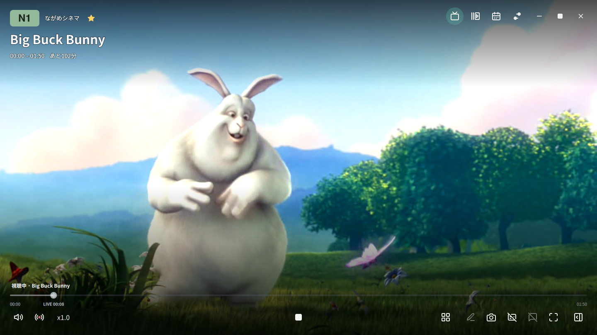
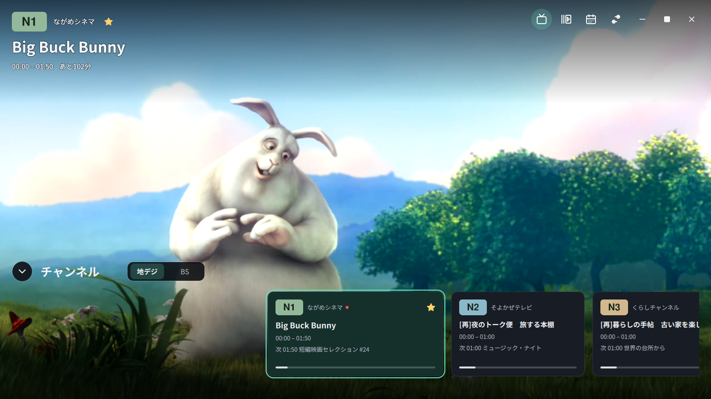
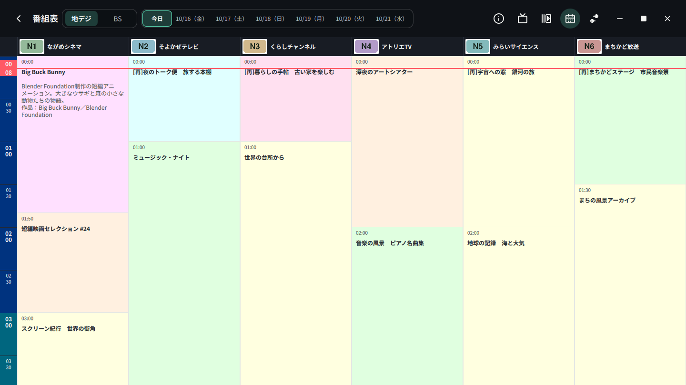
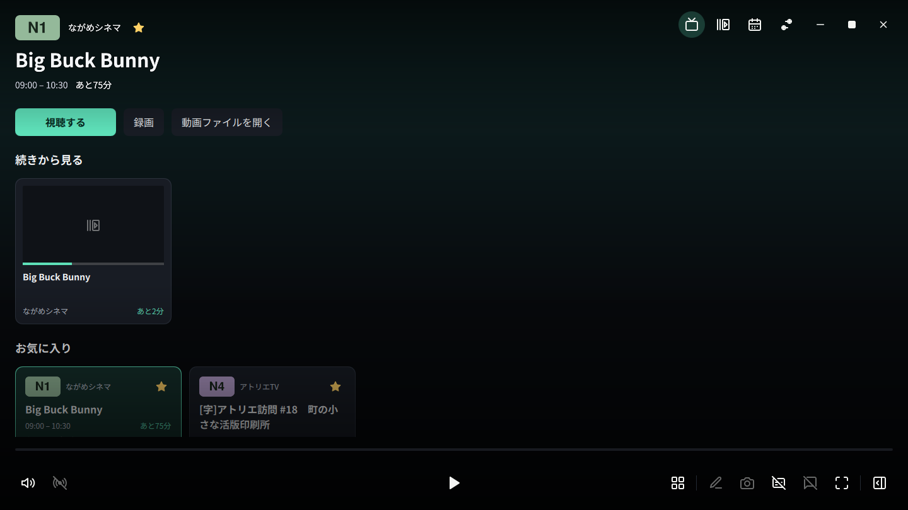
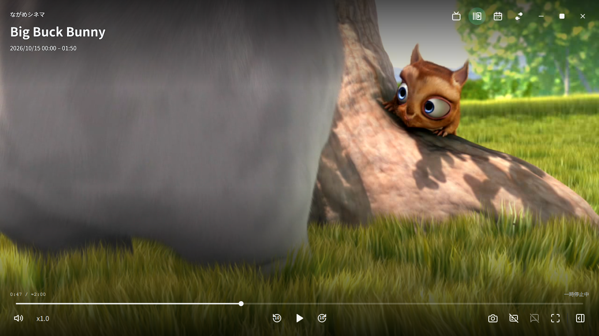

# ながめTV (NagameTV)

日本語 | [English](README.en.md)

ながめTVは、Linuxデスクトップで日本のテレビ放送と録画を楽しめる視聴アプリです。自宅のテレビサーバー（Mirakurun または mirakc）につないで地デジ・BS・CSの番組を見られるほか、手元の録画ファイル（TS）や動画ファイル（MP4・MKV）もそのまま再生できます。

7日分の番組表、テレビ放送の字幕表示、NX-Jikkyoと連携した実況コメントの表示・投稿にも対応しています。

**[最新版をダウンロード（Linux x86_64）](https://github.com/ouvill/NagameTV/releases/latest)** · [インストール](#インストール) · [使いかた](#使いかた)



| チャンネル一覧 | 番組表 |
| :---: | :---: |
|  |  |

---

## ながめTVでできること

- **テレビ放送の視聴とチャンネル選び**: Mirakurunまたはmirakcサーバーに接続して、地デジ・BS・CS・CATVの番組をリアルタイムで視聴できます。放送種別タブや局ロゴ入りの一覧から選べるほか、数字キーでのリモコン選局、`PgUp` / `PgDown` でのチャンネル送り、`L` キーでの直前チャンネル復帰に対応しています。お気に入り登録した局や途中まで見た録画はホーム画面にまとまります。また、視聴中はLinuxの画面消灯やスリープを防ぎます（対応デスクトップ環境 / [条件と詳細](docs/sleep-inhibit.md)）。

- **手元の録画・動画ファイルとEPGStationの再生**: ウィンドウへのドラッグ＆ドロップや「録画を開く」から、TS・MP4・MKVファイルを再生できます（テレビサーバーに接続する前でもそのまま使えます）。EPGStationの録画一覧からの検索・再生（stuayuフォーク版のログイン認証にも対応）や、録画URLを指定した再生も可能です。再生位置を記憶するため、次回は続きから再生できます。TSファイルでは、再生場面に合わせて番組名や説明・ジャンルも表示します。

- **一時停止・巻き戻し（タイムシフト）**: ライブ視聴中でも、一時停止した場面からの追いかけ再生や、少し前の場面への巻き戻し・倍速再生を利用できます（設定で「一時停止時のみ」「常に有効」「無効」から選べます）。

- **7日分の番組表と録画予約**: 今日から7日分の番組表で、複数チャンネルの放送予定や番組の詳細を確認できます。実験的機能を有効にすると、番組表からEPGStationへ番組単位の録画予約・取り消しも行えます（[対応範囲](docs/recording-reservations.md)）。

- **字幕・音声・データ放送**: テレビ放送の字幕（ARIB字幕、常時縁取りオプション付き）に加え、MP4・MKVの埋め込み字幕や外部字幕（SRT・ASS／SSA）の切り替えに対応しています。主音声・副音声・二重音声（主のみ／副のみ／ステレオ）の切り替えや、音量の記憶も可能です。実験的機能としてデータ放送の表示・リモコン操作も備えています。

- **実況コメント（NX-Jikkyo連携）とスクリーンショット**: 視聴中の局に合わせた実況コメントを映像上に流せます。横スクロールと下から弾む噴水表示の2種類から選べ、文字サイズ・濃さ・速さ・影を調整できます。専用の入力欄から自分のコメントを投稿したり、字幕やコメントごと映像をPNG画像として保存したりできます。

このほか、起動時の前回チャンネル自動再生、日本語／英語のUI切り替え、同じ家庭内LANの別端末から操作できるリモート機能、実験的機能としてLinux環境での[HDMI-CECテレビリモコン操作](docs/hdmi-cec.md)も利用できます。

---

## 動作環境

- **OS**: Linux デスクトップ環境（X11 または XWayland）
  - 動作確認済み: Ubuntu 24.04 LTS、Ubuntu 26.04 LTS、Fedora 40以降
- **音声**: PipeWire または PulseAudio
- **グラフィックス**: OpenGL対応のGPU環境を推奨
- **テレビ放送の視聴・番組表**: ネットワーク上に Mirakurun または mirakc サーバー（3.4.89で動作確認済み）が必要です。手元の録画や動画ファイルを再生するだけであれば、サーバーなしでそのまま利用できます。

---

## インストール

[GitHub Releases](https://github.com/ouvill/NagameTV/releases) の [最新の正式リリース](https://github.com/ouvill/NagameTV/releases/latest) を開き、ページ下部の **Assets** からお使いの環境に合うファイルを1つダウンロードしてください（先行版は Pre-release として公開されます）。

| 利用環境・形式 | ダウンロードするファイル（Linux x86_64 / amd64） |
| --- | --- |
| Ubuntu 24.04 | `nagametv_…ubuntu24.04_amd64.deb` |
| Ubuntu 26.04 | `nagametv_…ubuntu26.04_amd64.deb` |
| Flatpakを導入したLinux | `nagametv-…-x86_64.flatpak` |
| 単一ファイルから直接起動したいLinux（glibc 2.39以降） | `nagametv-…-x86_64.AppImage` |

※ 一覧が折りたたまれている場合は、**Assets** の見出しをクリックして展開してください。`Source code` はソースコード、`.zsync` はAppImage更新ツール用の補助ファイルです。

以下のコマンドはダウンロード先のフォルダーで実行します。ファイル名は実際に取得したものに読み替えてください。

### 1. Ubuntu debパッケージ（Ubuntu 24.04 / 26.04）

```sh
# Ubuntu 24.04 の場合
sudo apt install ./nagametv_0.1.0-1ubuntu24.04_amd64.deb

# Ubuntu 26.04 の場合
sudo apt install ./nagametv_0.1.0-1ubuntu26.04_amd64.deb
```

導入後はアプリ一覧または端末から `nagametv` で起動できます。更新や詳しい案内は [debパッケージの手順](docs/deb.md) を参照してください。

### 2. Flatpakパッケージ

ディストリビューションを問わず、サンドボックス環境で実行したい場合に向いています。

```sh
flatpak install --user ./nagametv-0.1.0-x86_64.flatpak
flatpak run io.github.ouvill.nagametv
```

必要なランタイムは導入時にFlathubから自動で取得されます。詳細は [Flatpakパッケージの手順](docs/flatpak.md) を参照してください。

### 3. AppImageパッケージ

システムへのインストール作業なしで、1つのファイルから直接起動したい場合に向いています。

```sh
chmod +x ./nagametv-0.1.0-x86_64.AppImage
./nagametv-0.1.0-x86_64.AppImage
```

[Gear Lever](https://flathub.org/apps/it.mijorus.gearlever) などの更新ツールを使うと、アプリ一覧への登録や差分更新ができます。詳しくは [AppImageの更新方法](docs/appimage.md#更新ツールで更新する) や [AppImageパッケージの手順](docs/appimage.md) を参照してください。

### アンインストール

削除方法や保存データの扱いは、導入した形式の手順を参照してください。

- [Ubuntu debパッケージ](docs/deb.md#インストール更新削除)
- [Flatpakパッケージ](docs/flatpak.md#アンインストール)
- [AppImageパッケージ](docs/appimage.md#更新削除)

---

## 使いかた

### 1. 初回設定（サーバーへの接続）
起動すると「Mirakurun / mirakc に接続」画面が開きます。稼働中のサーバーのURL（例: `http://192.168.1.100:40772`）を入力して「接続する」を押し、確認後に「チャンネルを選ぶ」を押すと視聴を始められます。接続先は後から「設定 → 接続」で変更できます。

手元の録画ファイルをすぐ再生したいときは、同じ画面の下にある「録画を開く」からファイルを選べます。

### 2. ホーム画面とチャンネル選び
再生を止めているときのホーム画面には、途中まで見た録画の「続きから見る」、お気に入りの局、いま放送中の番組が並びます。



視聴中にチャンネルを選ぶときは、画面下のチャンネル一覧ボタンまたは `S` キーで一覧を開き、地デジ・BSなどのタブで絞り込んでクリックします。`PgUp` / `PgDown` キーで前後の局へ、数字キー `1`〜`9`・`0`（10）と `1` に続く `0`・`1`・`2`（10〜12）でリモコン番号の局へ、`L` キーで直前に見ていた局へ切り替えられます。

局のカードや視聴画面左上の星マークを選ぶとお気に入りに登録でき、ホーム画面とチャンネル一覧では `F` キーでも切り替えられます。

### 3. 番組表を見る
`G` キーまたは右上の番組表ボタンから、7日分の番組表を確認できます。放送視聴中だけでなく、再生を止めているときやオフライン時でも開けます。

### 4. 録画や動画ファイルを再生する
ウィンドウへファイルをドラッグ＆ドロップするか、`Ctrl + O` キー（または右上の「録画を開く」）で、ファイル選択・EPGStationの録画一覧・録画URLの入力を開けます。再生中は `Space` キーで一時停止と再開、左右の矢印キーで10秒戻し・10秒送りが使えます。



録画は前回の位置から再生され、最後まで見終わった録画は視聴済みとして先頭から再生されます。ライブ視聴に戻るときは、右上のホームボタンやチャンネル一覧（`S` キー）から見たい局を選びます。

### 5. 実況コメントを見る・投稿する
コメント表示は初期設定でONです。表示の切り替え、動き方（横スクロール／噴水）、文字サイズや濃さは「設定 → コメント」または視聴中のサイドパネル「視聴設定」で調整できます。`C` キーで画面下部に投稿欄を開き、テキストを入力して `Ctrl + Enter`（設定により `Enter` 単体にも変更可能）で送信します。

### 6. スクリーンショットを撮る
再生バーのカメラボタンまたは `Ctrl + S` キーで、表示中の字幕や弾幕コメントを含めたPNG画像を保存します。初期設定の保存先はピクチャフォルダー配下の `nagametv`（通常は `~/ピクチャ/nagametv/`）で、保存先や画像形式は「設定 → 表示」で変更できます。

### 7. 実験的機能を使う（データ放送・録画予約・HDMI-CEC）
初期設定ではOFFになっており、必要なときに設定からONにして利用します。

- **データ放送**: 「設定 → 視聴 → データ放送を有効にする（実験的）」をONにすると、番組情報のサイドバーにあるリモコンからデータ放送を開いて操作できます（放送によっては表示や操作が正常に動作しない場合があります）。「データ放送を先読み」をONにすると開くまでの待ち時間を短くできますが、先読み中はメモリーとCPUの使用量が増えます。なお、放送側が自動起動を指定している番組では、先読みの設定にかかわらず自動で表示されます。データ放送内を戻るときはリモコンの「戻る」を使い、`Esc` キーで手前のサイドバーやパネルを閉じます。
- **番組表からの録画予約**: 「設定 → 接続」から有効にすると、番組表の番組詳細からEPGStationへ番組単位の予約追加・取り消しを行えます。
- **HDMI-CECリモコン操作**: Linuxの `/dev/cec*`（Raspberry PiやUSB CECアダプター等）を経由してテレビのリモコンから操作できます（[対応環境と制約](docs/hdmi-cec.md)、設定項目名はTBD）。

---

## キーボードショートカット

| キー | 動作 | 備考 |
| :--- | :--- | :--- |
| `↑` / `↓`、`Enter` | 映像から操作部へ移動 | 上で上部ナビゲーション、下・Enterで再生操作部へ。ボタン上では方向キーで移動、Enterで実行 |
| `S` | チャンネル一覧の開閉 | 放送局一覧を表示 |
| `C` | コメント投稿欄を開く | 入力欄へフォーカスを移動 |
| `G` | 番組表の開閉 | 7日分の番組表を表示 |
| `Space` | 再生 ／ 一時停止 | 映像にフォーカスがある録画再生中、および一時停止可能なライブ視聴中に有効 |
| `←` / `→` | 10秒戻る ／ 10秒進む | 映像にフォーカスがある録画再生中・タイムシフト再生中に有効。操作部ではフォーカス移動・値調整 |
| `PgUp` / `PgDown` | 前 ／ 次のチャンネルへ選局 | ライブ視聴時に有効 |
| `L` | 直前に見ていたチャンネルへ戻る | 戻れる局があるときに有効 |
| `0`〜`9` | リモコン番号の局へ選局 | ライブ視聴時に有効（文字入力・パネル操作時はそちらを優先） |
| `Ctrl + S` | スクリーンショットを保存 | 字幕・弾幕を含めてPNG保存 |
| `Ctrl + O` | 録画を開く（ファイル／URL） | 初回接続画面でも利用可能 |
| `F11` | 全画面表示の切り替え | 映像領域のダブルクリックでも切り替え可能 |
| `Escape` / 戻るボタン | パネルを閉じる ／ 映像へ戻る ／ 全画面解除 | 最前面から1段階ずつ戻る。キーボード・リモコンの戻るキーとマウスの戻るボタンに対応 |

コメント投稿欄などにカーソルがあるときは、文字キーの入力がそのまま文字入力に使われます。

---

## 設定の保存場所と便利な運用

### 設定ファイルの場所
接続先URL、最後に見ていた局、音量、各種表示設定は終了時に保存され、次回起動時に復元されます。

- **ネイティブ版・AppImage版**: `~/.config/nagametv/`（`$XDG_CONFIG_HOME/nagametv/`）
- **Flatpak版**: `~/.var/app/io.github.ouvill.nagametv/config/nagametv/`

「設定 → 視聴」にある「起動時に自動再生する」をONにすると、起動時に前回の局を自動で再生開始します。

### 別の端末からのリモート操作
同じ家庭内LANにあるスマートフォンや別のPCから、選局・再生制御・音量調節・字幕切り替えなどを行えるリモート操作機能を備えています。「設定 → リモート操作」から有効にできます（初期ポート: `50051`）。詳しい設定方法や対応機能は [リモート操作ガイド](docs/remote-control.md) を参照してください。

---

## 詳しいガイドと関連情報

- **利用ガイド**: [EPGStation連携](docs/epgstation.md) · [録画・動画ファイルの再生](docs/recording-playback.md) · [お気に入り・視聴履歴](docs/viewing-history.md) · [リモート操作](docs/remote-control.md)
- **開発・ビルド向け**: ソースコードからのビルド方法や技術仕様・API資料は [ドキュメント一覧](docs/README.md) や [開発・ビルド・診断ガイド](docs/development.md) を参照してください。

### 素材とクレジット
- **サンプル映像**: [Big Buck Bunny](https://peach.blender.org/about/)  
  (c) copyright 2008, Blender Foundation / [www.bigbuckbunny.org](https://www.bigbuckbunny.org) — [CC BY 3.0](https://creativecommons.org/licenses/by/3.0/)
- スクリーンショットの撮影素材および権利表記の詳細は [docs/media/README.md](docs/media/README.md) を参照してください。

### ライセンス
本プロジェクトのソースコードは、リポジトリ内のライセンス条項に基づいて公開されています。詳細は各ソースファイルおよびライセンス表記を確認してください。
